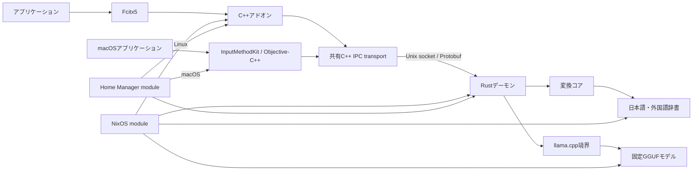

# アーキテクチャ

この文書は、現在のbeanKeyを構成するコンポーネントと、その依存境界を説明します。初期実装の計画や完了条件ではなく、実装を変更するときに維持すべき構造を対象にします。

Fcitx5とmacOSは対等なOSアダプタです。操作と使用感を共有し、互換性を改善するために両方を変更できます。macOSフロントエンドはInputMethodKit、Objective-C++、候補パネルを所有し、変換・学習・状態遷移は共通daemonが所有します。

## 全体構成

Fcitx5プロセスへロードするのはC++アドオンだけです。macOSではInputMethodKitのInput Methodが別プロセスで動作します。どちらも辞書変換、学習、Zenzai推論は共通のRustデーモンで実行し、変換やllama.cppの障害をフロントエンドから分離します。

## コンポーネント

| 場所 | 責任 |
| --- | --- |
| `crates/converter` | 入力状態、辞書読み込み、ラティス探索、候補生成、学習、Zenzai用promptとprefix制約付き再探索 |
| `crates/llama` | llama.cpp C APIのbinding、モデル読み込み、tokenize、decode、logit取得 |
| `crates/daemon` | 設定、Unix socket、Protobuf、入力セッション、converterとllamaの接続 |
| `fcitx5` | Fcitx5 key eventの正規化、プリエディット、候補UI、確定、デーモン起動 |
| `macos` | InputMethodKit、キー正規化、UTF-16変換、marked text、候補パネル、確定、デーモン起動 |
| `ipc` | RustとC++の通信契約（`beankey.proto`）、両フロントエンドの共有Unix socket transportと生成Protobuf型 |
| `nix` | package、固定資産、NixOS/Home Manager module、共有の導入optionとTOML生成 |

## 依存境界

`crates/converter`は変換ロジックの所有者です。Fcitx5、Protobuf、ソケット、llama.cpp C API、NixOS設定には依存しません。

`crates/llama`はllama.cpp固有の型、pointer、`unsafe`処理を内部へ閉じ込めます。固定した`llama-cpp-sys-2`の生成bindingを利用し、変換アルゴリズムとIPCは持ちません。

llama.cppはsys crateに同梱されたsourceからCargoで静的ビルドします。Nixと通常のCargo buildで別revisionを選ばず、system libraryや外部backend directoryへ切り替える経路も持ちません。CPU backendを使い、macOSではMetalも有効にします。[Cargoのビルド設定](../.cargo/config.toml)はx86の暗黙の追加ISAを抑制し、Metalのshader sourceを埋め込みます。shaderは実行時にMetal frameworkでコンパイルするため、別の`.metal`・`.metallib`資産は必要ありませんが、OS frameworkとC++ runtimeへの動的依存は残ります。

`crates/daemon`はconverterとllamaを組み合わせるアプリケーション境界です。辞書探索や候補順位付けを独自に実装しません。

Fcitx5とmacOSのフロントエンドは、Rust crateへ直接linkしません。候補の生成や並べ替えも行わず、デーモンの応答をOS側の入力APIへ反映します。共有transportはキー操作、入力状態、候補UIを知りません。

## 入力処理

1. フロントエンドがkey eventを、入力、削除、移動、変換、確定などの意味的な操作へ変換します。
2. フロントエンドが入力コンテキストに対応するsession IDとともに、要求をデーモンへ送ります。
3. デーモンがsessionの入力状態を更新し、converterへ変換を要求します。
4. Zenzai評価が必要な場合は、デーモンがconverterのdraft候補とllamaの評価を接続します。
5. デーモンがプリエディット、候補、予測、確定文字列、キーを処理したかどうかを返します。
6. フロントエンドは応答をFcitx5の標準UIとcommit API、またはInputMethodKitのmarked text・insertTextと非アクティブ候補パネルへ反映します。

同じsessionの要求は順番に処理します。異なるsessionの辞書処理は独立していますが、共有するllama.cpp contextへの推論は直列化します。

## Zenzai

Zenzaiは最終候補を一度だけ並べ替える処理ではありません。

1. converterが辞書ラティスからdraft候補を生成します。
2. 候補と周辺文脈からpromptを構築します。
3. llama.cppが候補tokenを評価します。
4. モデルが別のtokenを選んだ場合、その位置までのUTF-8 prefixを取得します。
5. converterがprefixを制約として辞書ラティスを再探索します。
6. 候補が通過するか、全文が確定するか、推論回数の上限に達するまで繰り返します。

converterはpromptと再探索、llama crateはモデル操作、デーモンは両者の進行を所有します。

## IPCとプロセス

フロントエンドとデーモンは、明示したruntime root内の`beankey/daemon.sock`で通信します。Linuxのrootは`$XDG_RUNTIME_DIR`、macOSは`~/Library/Caches/beanKey/runtime`です。wire formatはvarint length-delimited Protobufで、1 messageの上限は1 MiBです。

各envelopeはprotocol version、request ID、session ID、payloadを持ちます。Fcitx5固有のkey symbolはwireへ流さず、意味的な操作だけを送ります。

フロントエンドがsocketへ接続できない場合は、Nix store pathへ固定された`beankey-daemon`を直接起動して再接続します。systemd service、socket activation、LaunchAgentは使用しません。最後のclientが切断し、sessionがなくなるとデーモンも終了します。

runtime directoryはmode `0700`、socketはmode `0600`です。デーモンはLinuxの`SO_PEERCRED`、macOSの`getpeereid`で接続peerのUIDを検証し、自分と異なるUIDからの接続を拒否します。stale socketはprocess lockを取得した同一UIDのデーモンだけが削除できます。

## 障害時の扱い

フロントエンドからデーモンへの要求には5秒の期限があります。接続、要求、応答に失敗した場合、対応するsession、プリエディット、候補をresetします。

応答を得ていないキーは未処理としてアプリケーションへ返します。フロントエンド内でkey eventをbufferしたり、自動的に再送したりはしません。

macOSでは、接続とdaemon起動の準備をbackgroundで行い、準備前のキーは未処理として返します。接続の世代が変わった後は旧sessionを使いません。準備後の要求とUI更新はmain threadで直列処理します。

## macOSの入力境界

InputMethodKitがクライアントごとに作るcontrollerとdaemon sessionを1対1に対応させます。キー入力、候補の番号・クリック選択、学習忘却、入力訂正は既存の意味的操作へ変換します。候補パネルはフォーカスを奪わず、caretの画面座標と画面端に合わせて配置します。

wire上のUnicode scalar offsetとCocoaのUTF-16 offsetは`macos`内で変換します。周辺文脈は選択位置の前後だけを取得し、編集中のmarked textを除外します。クライアントが範囲を提供しない場合は、文脈を取得できないことをdaemonへ伝えます。

候補の確定は、固定したazooKey Desktopと同様に文字列の挿入だけを行います。Fcitx5でも通常のcommit APIを使い、確定後にカーソル位置を調整する追加アクションは生成・転送しません。

## 設定

NixOSとHome Managerは、[共通の設定生成](../nix/settings.nix)で`programs.beanKey.settings`をそのままTOMLへ書き出します。キー・構造は手書きTOMLと共通で、未指定の項目は出力しません。`settings = { };`では空ファイルを生成します。

既定値と検証は[daemon](../crates/daemon/src/config.rs)が所有します。空TOMLやtableの省略には既定値を適用し、未知のキーや不正な値はdaemon起動時に拒否します。導入用の`enable`と`useBeanKeyTheme`はTOMLに含めません。

固定資産はdaemonの正規化した実行ファイルから`../share/beankey`を解決して読み込みます。固定辞書やモデルのpath、socket名は設定へ書きません。runtime rootと学習directoryはフロントエンドが指定します。

## Linux統合

NixOS moduleは次のものを導入します。

- Fcitx5アドオン
- Rustデーモン
- 固定辞書と絵文字辞書
- 固定GGUFモデル
- リポジトリに固定した英語・ギリシャ語のHunspell形式辞書

NixOS moduleは生成TOMLを`/etc/beankey/config.toml`から参照させます。Linux用Home Manager moduleは同じ設定を`xdg.configHome`配下の`beankey/config.toml`へ配置します。Fcitx5の導入とテーマ設定は[共通のFcitx5設定](../nix/fcitx5.nix)を使います。

アドオンは`$XDG_CONFIG_HOME/beankey/config.toml`（未指定・空・相対パスの場合は`$HOME/.config/beankey/config.toml`）を優先し、未配置の場合だけ`/etc/beankey/config.toml`を指定してデーモンを起動します。ユーザー設定へのリンク切れやアクセスエラーを、システム設定への切り替えで隠しません。利用者の設定値や生成TOMLのstore pathはアドオンへ埋め込みません。

Fcitx5はNixOSかHome Managerの一方で管理します。beanKey daemonはどちらの場合もアドオンが必要時に直接起動し、専用のsystemd unitは作成しません。

モデル、辞書、実行ファイルはNix storeへ置きます。学習データなどの可変状態はユーザーのXDG state directoryに置き、Nix管理の不変資産と分離します。

## macOS統合

macOS packageはdaemonのNix store pathをbundleへ埋め込みます。利用者ごとの設定はbundleに含めないため、`programs.beanKey.settings`を変えてもInputMethodKit packageは変わりません。

Home Manager moduleは生成TOMLを`~/Library/Application Support/beanKey/config.toml`から参照させます。単体installerはこのパスに設定もリンクもない場合だけ、一部の既定値を記載したサンプルを生成します。既存設定の内容は検証・変更しません。フロントエンドは設定が読み取れるファイルかを確認し、内容の読み込みと検証はdaemonが行います。

Home Manager moduleは`beankey-install`をactivationで実行します。installerは署名したbundleの実体を`~/Library/Input Methods/beanKey.app`へ置き、公開TIS APIで登録します。有効化・選択は利用者がシステム設定で行い、既存の入力ソースは変更しません。Home Managerはpackage・設定の変更時などに旧プロセスを停止します。単体installerは停止しないため、更新が反映されない場合は再ログインしてください。

単体インストールでもNix storeのdaemonと動的ライブラリがGCで削除されないよう、`~/Library/Application Support/beanKey/package`をpackageへの間接GC rootにします。更新時には同じ参照を新packageへ置き換えます。

学習データは`~/Library/Application Support/beanKey/learning`、daemonの起動ログは`~/Library/Logs/beanKey/daemon.log`に保存します。独自設定GUIは提供しません。

## 配布資産

日本語辞書と絵文字辞書は[Git submodule](../.gitmodules)でrevisionを固定し、生成済みデータを直接packageします。英語・ギリシャ語のHunspell形式辞書とn-gram用tokenizer JSONはリポジトリ内の固定コピーを使います。モデルは[資産定義](../nix/assets.nix)の`fetchurl`でrevisionとhashを固定して取得します。

[daemon package](../nix/packages.nix)は`share/beankey`以下へ日本語辞書、絵文字、モデル、英語・ギリシャ語辞書を配置します。tokenizerはこの配置には含まれず、n-gram入力訂正を使う場合に設定でpathを指定します。

辞書テストはリポジトリ内の資産を参照します。固定GGUFモデルのテスト用pathだけを`BEANKEY_TEST_MODEL`で渡し、daemonの利用者設定には使いません。

直接配布する辞書、絵文字データ、tokenizer、GGUFモデルには、資産ごとのlicense本文、取得元、固定revision、attributionをNix packageへ同梱します。

llama.cppはCargo依存として管理し、sys crateに同梱されたsourceを独自にvendorしません。daemon packageは静的linkしたllama.cppなどの必要なlicense本文とnoticeを同梱し、辞書・モデルの資産台帳とは分離します。英語・ギリシャ語辞書の取得元、revision、hash、licenseは[THIRD_PARTY_NOTICES.txt](../THIRD_PARTY_NOTICES.txt)へ記録します。候補生成にはCargo依存のspellbookを使い、Hunspell本体へはリンクしません。製品のビルドと実行にSwiftは使用しません。

`converter`はaffixファイルの`SET`に従って両辞書ファイルをUTF-8へdecodeし、専用workerでspellbookの候補を生成して入力prefixと一致するものを返します。辞書の欠損、不正なencoding、decode失敗、parse失敗ではロードを失敗させます。対話的な補完の遅延を抑えるため、n-gram候補生成は無効にします。
